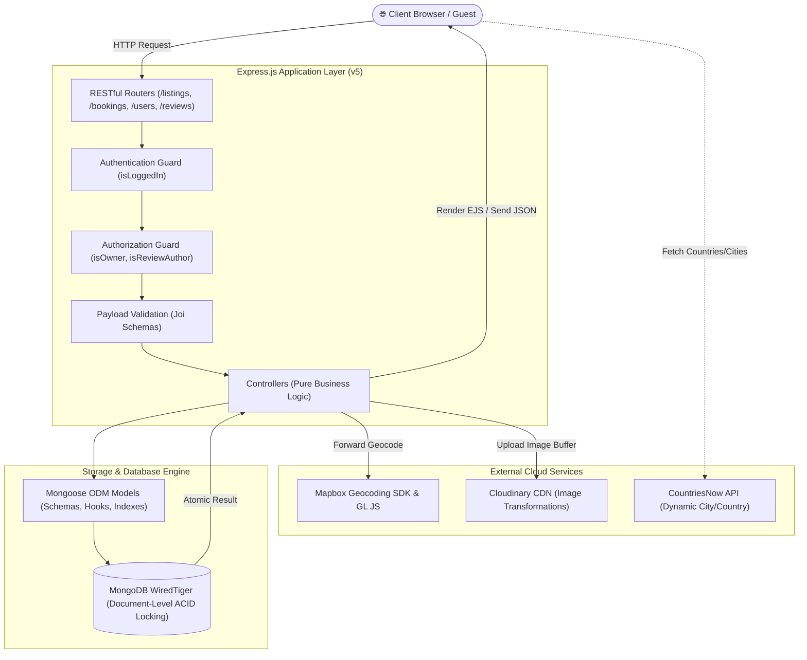

# 🏨 AthithiBandhu — Full-Stack Vacation Rental Marketplace

<p align="center">
  
  
  
  
  
  
  
</p>

---

## 📖 Table of Contents
1. [Overview & Value Proposition](#-overview--value-proposition)
2. [Application Showcase](#-application-showcase)
3. [System Architecture](#-system-architecture)
4. [Key Engineering Deep-Dives](#-key-engineering-deep-dives)
   - [Atomic Concurrency & Race Condition Elimination](#1-atomic-concurrency--race-condition-elimination)
   - [Regional Currency & Taxation Rules Engine](#2-regional-currency--taxation-rules-engine)
   - [Dynamic Forward Geocoding with Mapbox GL](#3-dynamic-forward-geocoding-with-mapbox-gl)
   - [Cloudinary Media Pipeline & Storage](#4-cloudinary-media-pipeline--storage)
5. [Database Modeling & Schema Design](#-database-modeling--schema-design)
6. [RESTful API Specification](#-restful-api-specification)
7. [Security & Production Hardening](#-security--production-hardening)
8. [Directory Structure](#-directory-structure)
9. [Getting Started & Local Setup](#-getting-started--local-setup)
10. [Author & License](#-author--license)

---

## 🌐 Overview & Value Proposition

**AthithiBandhu** (inspired by the Sanskrit philosophy *"Atithi Devo Bhava"* — Guest is God) is a full-stack, production-grade hospitality marketplace connecting travelers with unique accommodations worldwide.

Designed and engineered to meet the technical standards of top-tier engineering organizations (**FAANG / MAANG**), this platform goes beyond a basic CRUD project by solving real-world distributed systems challenges:
* **ACID-Compliant Concurrency**: Guarantees zero double-booking race conditions at the database storage engine layer.
* **Regional Intelligence**: Automatically adapts currency symbols, formatting locales, and regional hospitality taxes (e.g., GST in India, Lodging Tax in USA, VAT in Europe).
* **High-Precision Geospatial Integration**: Translates physical addresses into GeoJSON coordinates on the fly via Mapbox SDK and visualizes them on hardware-accelerated interactive maps.
* **Strict MVC Modularity**: Clean separation of Models, Views, Controllers, Middlewares, and Utilities for enterprise scalability.

---

## 📸 Application Showcase

| 🌟 Explore Listings & Categories | 🏡 Listing Details & Live Pricing |
| :---: | :---: |
|  |  |

| 🗺️ Interactive Dynamic Mapbox | 🌐 Multi-Currency & Language Modal |
| :---: | :---: |
|  |  |

| 📅 Guest Bookings Dashboard | ✍️ Host Listing Creation & Map Preview |
| :---: | :---: |
|  |  |

| 🔐 User Signup with Dynamic Geo API | 🔑 Secure Session Authentication |
| :---: | :---: |
|  |  |

---

## 🏛️ System Architecture

AthithiBandhu follows a strict **Model-View-Controller (MVC)** design pattern, keeping route declarations declarative, business logic decoupled in dedicated controllers, and views cleanly organized.



---

## ⚡ Key Engineering Deep-Dives

### 1. Atomic Concurrency & Race Condition Elimination
* **The Problem**: In hospitality booking systems, a high-frequency race condition ("Check-Then-Act") occurs when two concurrent guests query availability for the same listing and overlapping dates at the exact same millisecond. Traditional multi-step logic (`isAvailable() -> saveBooking()`) results in severe double-booking bugs.
* **The Engineering Solution**: AthithiBandhu leverages MongoDB’s document-level ACID guarantees inside the **WiredTiger** storage engine. By maintaining a discrete `bookedDates` array of unique ISO night strings (`YYYY-MM-DD`) on the listing document, reservation is handled via a **single atomic instruction**:
  ```javascript
  const reservedListing = await Listing.findOneAndUpdate(
      { 
          _id: id, 
          bookedDates: { $nin: requestedDates } 
      },
      { 
          $push: { bookedDates: { $each: requestedDates } } 
      },
      { new: true }
  );

  if (!reservedListing) {
      req.flash("error", "The selected dates were just reserved by another guest. Please choose alternative dates.");
      return res.redirect(`/listings/${id}`);
  }
  ```
  * **Result**: The first client acquiring the document lock evaluates `$nin` to `true`, atomically appends the dates, and commits. Any overlapping concurrent request evaluates `$nin` to `false`, returning `null`. This guarantees zero double-bookings without needing complex distributed Redis lock managers.
  * **Cancellation**: Cancelled stays atomically `$pull` the dates back out of `bookedDates`, instantly releasing inventory.

---

### 2. Regional Currency & Taxation Rules Engine
Accommodations span multiple countries with differing currency symbols, formatting standards, and regional hospitality taxes. AthithiBandhu features a built-in regional taxation rules engine ([utils/currency.js](file:///c:/Users/tusha/OneDrive/Documents/WebDev/MAJORPROJECT/utils/currency.js)):
* **Dynamic Geocoding Mapping**: Automatically detects the country and applies localized rules:
  * 🇮🇳 **India**: `INR (₹)`, locale `en-IN`, 18% GST.
  * 🇺🇸 **USA**: `USD ($)`, locale `en-US`, 14% Lodging Tax & Tourism Fees.
  * 🇬🇧 **UK**: `GBP (£)`, locale `en-GB`, 20% VAT & Hospitality Tax.
  * 🇪🇺 **Eurozone**: `EUR (€)`, locale `de-DE`/`it-IT`/`fr-FR`, 10–14% City Tourism Tax.
  * 🇦🇪 **UAE**: `AED`, locale `en-AE`, 10% Tourism Fee & Municipality Tax.
  * 🇯🇵 **Japan**: `JPY (¥)`, locale `ja-JP`, 10% Consumption Tax.
* **Client-Side Live Conversions**: Guests can toggle pre-tax and tax-inclusive pricing with one click or open the multi-currency modal to convert listings globally using live exchange normalization.

---

### 3. Dynamic Forward Geocoding with Mapbox GL
* On listing creation or update, the property's address is submitted to Mapbox’s Forward Geocoding API (`@mapbox/mapbox-sdk/services/geocoding`).
* GeoJSON coordinates `[longitude, latitude]` are validated with boundary bounds checking (`[-180, 180]`, `[-90, 90]`) and stored directly within MongoDB.
* The frontend initializes a responsive **Mapbox GL JS** instance featuring:
  * Custom styled map pins.
  * Interactive popups with property details.
  * Fullscreen controls & zoom navigation.
  * Coordinate fallback resolution for legacy/seed data.

---

### 4. Cloudinary Media Pipeline & Storage
* Images are parsed directly from multi-part form data via `multer` and streamed directly to **Cloudinary** using `multer-storage-cloudinary-v2`.
* Automatically transforms user-uploaded assets into optimized WebP/JPEG formats, enforces filetype whitelisting, and isolates staging folders.

---

## 🗄️ Database Modeling & Schema Design

```
+-------------------------------------------------------+
|                       User                            |
+-------------------------------------------------------+
| _id: ObjectId (PK)                                    |
| username: String (Unique)                             |
| email: String (Unique, Indexed)                       |
| name: String                                          |
| dateOfBirth: Date                                     |
| city: String                                          |
| country: String                                       |
| sex: Enum ("Male", "Female", "Other", "Prefer not")   |
+-------------------------------------------------------+
                           | 1
                           | 
                           | owns
                           v *
+-------------------------------------------------------+
|                      Listing                          |
+-------------------------------------------------------+
| _id: ObjectId (PK)                                    |
| title: String                                         |
| description: String                                   |
| image: { url: String, filename: String }              |
| price: Number                                         |
| location: String                                      |
| country: String                                       |
| category: String (Default: "Popular")                 |
| isGuestFavourite: Boolean                             |
| bookedDates: [String] (ISO: "YYYY-MM-DD")             |
| geometry: { type: "Point", coordinates: [Lng, Lat] }  |
| owner: ObjectId -> User                               |
| reviews: [ObjectId -> Review]                         |
+-------------------------------------------------------+
         | 1                                  | 1
         | has                                | receives
         v *                                  v *
+-------------------------+       +-------------------------+
|        Booking          |       |         Review          |
+-------------------------+       +-------------------------+
| _id: ObjectId (PK)      |       | _id: ObjectId (PK)      |
| listing: -> Listing     |       | rating: Number (1-5)    |
| user: -> User           |       | comment: String         |
| checkIn: Date           |       | createdAt: Date         |
| checkOut: Date          |       | author: -> User         |
| totalNights: Number     |       +-------------------------+
| nightlyPrice: Number    |
| taxAndFees: Number      |
| totalPrice: Number      |
| bookedDates: [String]   |
| status: "confirmed"     |
|         "cancelled"     |
| listingTitle: String    |
| listingImage: String    |
| listingLocation: String |
+-------------------------+
```

### Key Schema Optimizations:
1. **Compound Index**: `bookingSchema.index({ listing: 1, user: 1, status: 1 })` optimizes dashboard queries for user reservation history.
2. **Snapshot Persistence**: `Booking` documents preserve listing snapshots (`listingTitle`, `listingImage`, `listingLocation`) so past bookings remain readable even if a host edits or deletes the original property.
3. **Cascade Deletes**: Mongoose `post("findOneAndDelete")` lifecycle hooks automatically prune orphaned reviews when a listing is deleted.

---

## 📡 RESTful API Specification

| HTTP Verb | Endpoint | Middleware Guards | Description |
| :--- | :--- | :--- | :--- |
| **GET** | `/listings` | None | Browse all listings, filter by category, or search destinations |
| **GET** | `/listings/new` | `isLoggedIn` | Render listing creation form |
| **POST** | `/listings` | `isLoggedIn`, `upload.single()`, `validateListing` | Publish new listing with Mapbox geocoding & Cloudinary upload |
| **GET** | `/listings/:id` | None | View detailed listing page, reviews, and interactive map |
| **GET** | `/listings/:id/edit` | `isLoggedIn`, `isOwner` | Render edit form for listing owner |
| **PUT** | `/listings/:id` | `isLoggedIn`, `isOwner`, `upload.single()`, `validateListing` | Update listing details and re-geocode coordinates |
| **DELETE** | `/listings/:id` | `isLoggedIn`, `isOwner` | Delete listing and cascade delete its reviews |
| **POST** | `/listings/:id/bookings` | `isLoggedIn` | Reserve stay dates (Atomic Concurrency Protected) |
| **GET** | `/bookings` | `isLoggedIn` | View authenticated user's reservation dashboard |
| **DELETE** | `/bookings/:bookingId` | `isLoggedIn` | Cancel booking and release dates back to listing inventory |
| **DELETE** | `/bookings/:bookingId/remove` | `isLoggedIn` | Permanently remove reservation record from user history |
| **POST** | `/listings/:id/reviews` | `isLoggedIn`, `validateReview` | Submit a review with star rating for a listing |
| **GET** | `/listings/:id/reviews/:reviewId/edit` | `isLoggedIn`, `isReviewAuthor` | Render review edit form |
| **PUT** | `/listings/:id/reviews/:reviewId` | `isLoggedIn`, `isReviewAuthor`, `validateReview` | Update rating and review comment |
| **DELETE** | `/listings/:id/reviews/:reviewId` | `isLoggedIn`, `isReviewAuthor` | Remove review from listing |
| **GET** | `/users/signup` | None | Render registration page |
| **POST** | `/users/signup` | None | Register new user account |
| **GET** | `/users/login` | None | Render authentication login page |
| **POST** | `/users/login` | `savedRedirectUrl`, `passport.authenticate()` | Authenticate credentials and restore target URL |
| **POST** | `/users/logout` | None | Invalidate session cookie and log out |

---

## 🔒 Security & Production Hardening

1. **Joi Schema Validation**: Incoming payloads are validated against strict schemas before hitting controllers, mitigating malformed inputs and prototype pollution.
2. **Regex Injection Protection**: User search keywords are sanitized with regex escape sequences (`/[.*+?^${}()|[\]\\]/g`) to prevent catastrophic backtracking (ReDoS).
3. **Session Cookie Hardening**:
   ```javascript
   cookie: {
       httpOnly: true, // Prevents XSS script access to session tokens
       sameSite: "lax", // Mitigates Cross-Site Request Forgery (CSRF)
       secure: process.env.NODE_ENV === "production", // Enforces HTTPS in production
       maxAge: 7 * 24 * 60 * 60 * 1000
   }
   ```
4. **Environment Isolation**: Sensitive credentials (Mapbox public tokens, Cloudinary API secrets, MongoDB URIs) are kept strictly out of version control via `.env` and `.gitignore`.
5. **Centralized Error Boundary**: Universal Express error handling middleware traps asynchronous rejections, provides user-friendly status pages, and masks internal stack traces in production.

---

## 📂 Directory Structure

```
AthithiBandhu/
├── assets/
│   └── screenshots/            # High-resolution portfolio showcase imagery
├── controllers/                # Business logic handlers (MVC)
│   ├── booking.js              # Booking creation, atomic concurrency & cancellation
│   ├── listing.js              # Listings CRUD, search filters & Mapbox geocoding
│   ├── review.js               # Review submission, edit & removal
│   └── user.js                 # Authentication & registration workflows
├── models/                     # Mongoose Schemas & Lifecycle Hooks
│   ├── booking.js              # Booking model & compound indexing
│   ├── listing.js              # Listing model, GeoJSON point & cascade delete hooks
│   ├── review.js               # Star ratings & comment reviews
│   └── user.js                 # User credentials & passport-local-mongoose plugin
├── routes/                     # RESTful Router Modules
│   ├── booking.js              # /bookings endpoints
│   ├── listing.js              # /listings endpoints
│   ├── review.js               # /listings/:id/reviews endpoints
│   └── user.js                 # /users authentication endpoints
├── views/                      # Server-Rendered EJS Views & Layouts
│   ├── bookings/               # User bookings dashboard
│   ├── includes/               # Navbar, footer, flash alerts, language/currency modal
│   ├── layouts/                # Boilerplate master layout
│   ├── listings/               # Index catalog, show details, new/edit forms
│   ├── reviews/                # Review editing forms
│   └── users/                  # Login and signup views
├── public/                     # Static Client Assets
│   ├── css/                    # Modular stylesheets (listings, navbar, forms, style)
│   └── js/                     # Client scripts (Mapbox GL, currency converter, live booking)
├── utils/                      # Shared Helper Utilities
│   ├── currency.js             # Regional currency & hospitality tax engine
│   ├── ExpressErrors.js        # Custom error class with HTTP status codes
│   └── wrapAsync.js            # Asynchronous route wrapper
├── init/                       # Database Initialization & Sample Data
│   ├── data.js                 # Curated global listing seed records
│   └── index.js                # Database seeder script
├── cloudConfig.js              # Cloudinary SDK & Multer storage configuration
├── middleware.js               # Centralized auth, permission & validation guards
├── schema.js                   # Joi validation schemas
├── app.js                      # Express server entry point & middleware chain
├── LICENSE                     # MIT Open-Source License
└── package.json                # Project dependencies and npm scripts
```

---

## 🚀 Getting Started & Local Setup

### 1. Prerequisites
* **Node.js** (v18.x or later)
* **MongoDB** (Local instance or MongoDB Atlas cluster)
* **Mapbox Account** (Public access token)
* **Cloudinary Account** (Cloud name, API key, API secret)

### 2. Clone the Repository
```bash
git clone https://github.com/tusharr-mishra/AthithiBandhu.git
cd AthithiBandhu
```

### 3. Install Dependencies
```bash
npm install
```

### 4. Configure Environment Variables
Create a `.env` file in the project root:
```env
PORT=8080
MONGO_URL=mongodb://127.0.0.1:27017/AthithiBandhu
SESSION_SECRET=your_super_secret_session_key
MAPBOX_TOKEN=pk.your_mapbox_public_token
CLOUDINARY_CLOUD_NAME=your_cloudinary_cloud_name
CLOUDINARY_API_KEY=your_cloudinary_api_key
CLOUDINARY_API_SECRET=your_cloudinary_api_secret
```

### 5. Seed the Database (Optional)
To initialize the database with curated sample listings from around the world:
```bash
node init/index.js
```

### 6. Run the Application
```bash
# Development mode with Nodemon
npm run dev

# Production mode
npm start
```

Open your browser and navigate to `http://localhost:8080`.

---

## 👤 Author & License

* **Author**: [Tushar Mishra](https://github.com/tusharr-mishra)
* **License**: This project is licensed under the [MIT License](LICENSE) — feel free to explore, learn, and adapt for your own educational projects!
