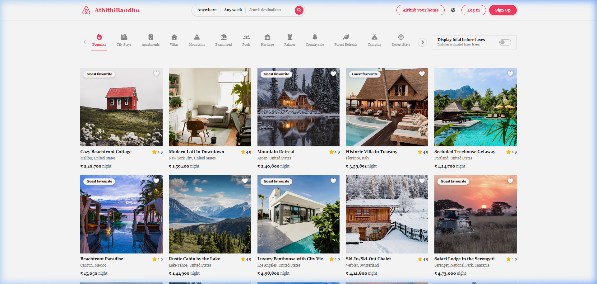
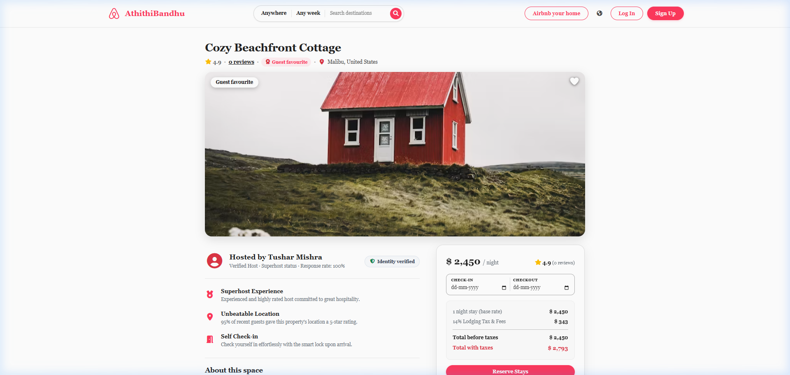
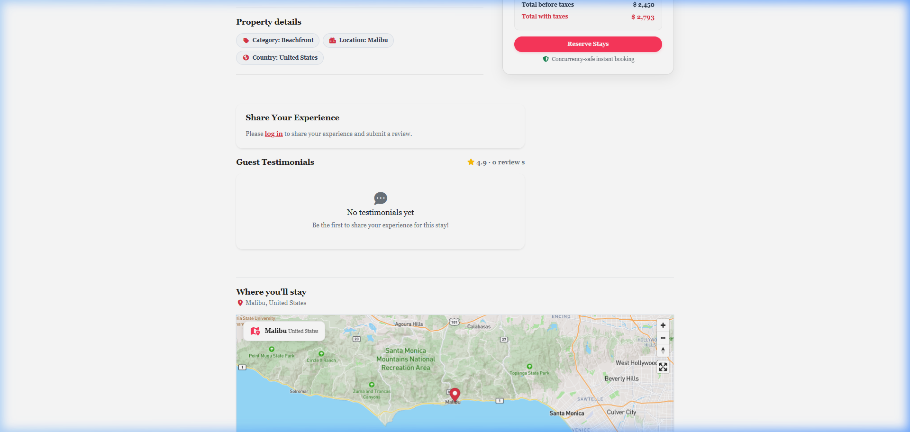
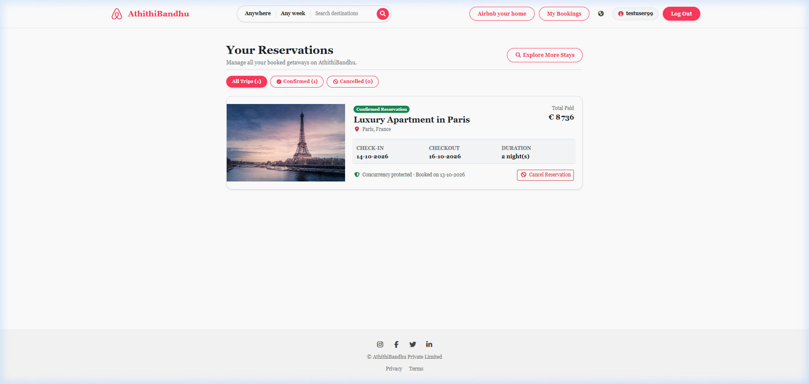
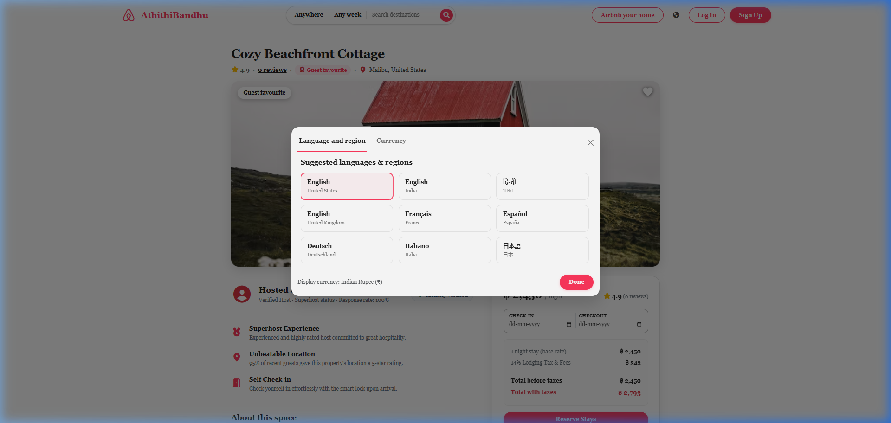
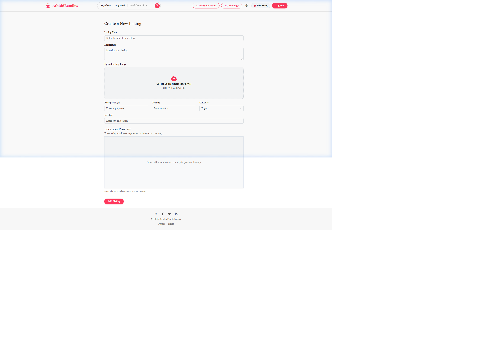
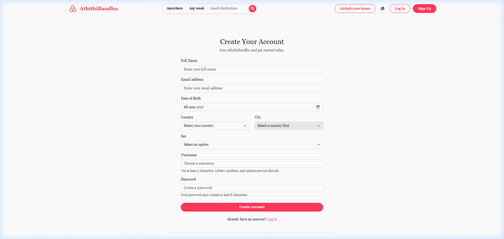
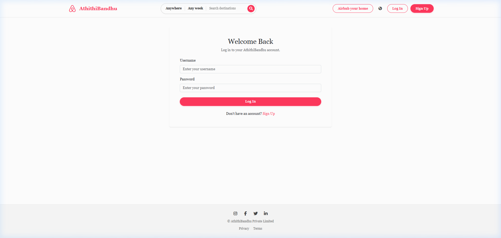
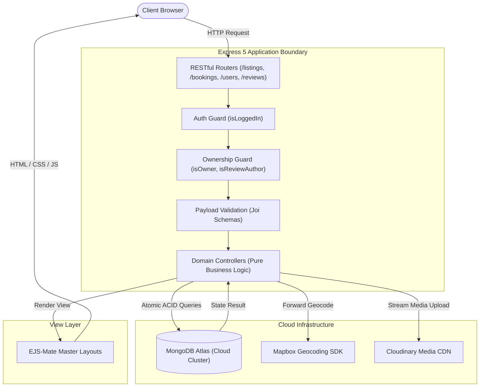

<div style="font-family: 'Times New Roman', Times, serif;">

# AthithiBandhu — Vacation Rental & Hospitality Platform

<p align="center">
  <a href="https://athithibandhu.onrender.com" target="_blank">
    
  </a>
  <a href="https://github.com/tusharr-mishra/AthithiBandhu" target="_blank">
    
  </a>
  
  
  
  
</p>

<div align="center">

| Deployment Resource | Target URL / Status |
| :--- | :--- |
| **Production Web Service** | `https://athithibandhu.onrender.com` |
| **API Health Status** | `Operational — HTTP 200 OK` |
| **Database Cluster** | `MongoDB Atlas (Cloud Database Cluster0)` |

</div>

---

## Table of Contents
1. [Executive Summary](#executive-summary)
2. [Core Application Showcase](#core-application-showcase)
3. [System Architecture & MVC Implementation](#system-architecture--mvc-implementation)
4. [Engineering Deep-Dives](#engineering-deep-dives)
   - [Atomic Concurrency & Double-Booking Elimination](#1-atomic-concurrency--double-booking-elimination)
   - [Regional Currency & Taxation Rules Engine](#2-regional-currency--taxation-rules-engine)
   - [Dynamic Forward Geocoding with Mapbox GL](#3-dynamic-forward-geocoding-with-mapbox-gl)
   - [Cloudinary Media Storage Pipeline](#4-cloudinary-media-storage-pipeline)
   - [Persistent MongoStore Session Architecture](#5-persistent-mongostore-session-architecture)
5. [Database Modeling & Schema Design](#database-modeling--schema-design)
6. [RESTful API Specification](#restful-api-specification)
7. [Security & Production Hardening](#security--production-hardening)
8. [Directory Structure](#directory-structure)
9. [Local Setup & Environment Configuration](#local-setup--environment-configuration)
10. [Author & License](#author--license)

---

## Executive Summary

**AthithiBandhu** is a full-stack hospitality marketplace engineered to reflect enterprise-level standards suitable for top-tier software engineering teams. Inspired by the philosophy *"Atithi Devo Bhava"*, the platform delivers a reliable, end-to-end reservation experience across international destinations.

### Key Differentiators
* **ACID Concurrency Protection**: Solves the classic distributed double-booking race condition directly at the storage engine layer using atomic conditional updates.
* **Regional Intelligence**: Dynamically resolves currency symbols, formatting locales, and regional hospitality taxes (e.g. 18% GST in India, 14% Lodging Tax in USA, 20% VAT in UK) based on destination coordinates.
* **Geospatial Precision**: Forward-geocodes addresses into GeoJSON Point coordinates with boundary validation and displays interactive Mapbox GL JS map views.
* **Enterprise Modularity**: Structured on a clean Model-View-Controller (MVC) pattern with centralized middleware guards and persistent cloud session caching via `connect-mongo`.

---

## Core Application Showcase

<div align="center">

| Explore Listings & Categories | Listing View & Sticky Reservation Card |
| :---: | :---: |
|  |  |
| *Destination search, category navigation & price display* | *Pricing breakdown, reviews & guest reservation form* |

| Interactive Dynamic Mapbox | Guest Bookings Dashboard |
| :---: | :---: |
|  |  |
| *Real-time geocoded coordinates, pins & popups* | *Trip history, status badges & cancellation actions* |

</div>

<details>
<summary><b>View Additional Application Interfaces (Auth & Property Creation)</b></summary>
<br>
<div align="center">

| Multi-Currency & Language Modal | Property Creation with Live Preview |
| :---: | :---: |
|  |  |

| User Registration (Geo API) | Authentication Login Page |
| :---: | :---: |
|  |  |

</div>
</details>

---

## System Architecture & MVC Implementation

The application is architected around strict Model-View-Controller separation, ensuring decoupling between routing, domain logic, and presentation.

<div align="center">



</div>

---

## Engineering Deep-Dives

### 1. Atomic Concurrency & Double-Booking Elimination
* **The Engineering Problem**: When multiple users attempt to reserve the same listing for overlapping dates simultaneously, standard non-atomic patterns (`isAvailable() -> saveBooking()`) introduce a "Check-Then-Act" race condition. Both requests observe available slots and confirm conflicting stays.
* **The Solution**: AthithiBandhu tracks reserved nights as an array of unique ISO date strings (`YYYY-MM-DD`) on the `Listing` document. The reservation query combines availability verification and reservation into a single atomic instruction executed via MongoDB's WiredTiger storage engine:

```javascript
// Atomic reservation instruction: prevents race conditions at the storage engine level
const reservedListing = await Listing.findOneAndUpdate(
    {
        _id: id,
        bookedDates: { $nin: requestedDates }
    },
    {
        $push: { bookedDates: { $each: requestedDates } }
    },
    { new: true }
);

if (!reservedListing) {
    req.flash("error", "The selected dates were just reserved by another guest. Please choose alternative dates.");
    return res.redirect(`/listings/${id}`);
}
```

* **Guarantee**: MongoDB's single-document write lock ensures only the first arrival acquires the lock, appends the dates, and commits. Competing concurrent queries evaluate `$nin` as false and return `null`, entirely preventing double bookings without requiring external lock orchestrators.
* **Release on Cancellation**: Cancelled stays atomically invoke `$pull: { bookedDates: { $in: booking.bookedDates } }` to immediately release inventory.

---

### 2. Regional Currency & Taxation Rules Engine
Accommodations span multiple international jurisdictions. The currency engine (`utils/currency.js`) dynamically configures pricing structures and tax percentages based on destination country:

<div align="center">

| Region / Country | Currency Code | Symbol | Formatting Locale | Regional Hospitality Tax |
| :--- | :--- | :--- | :--- | :--- |
| **India** | `INR` | ₹ | `en-IN` | **18% GST** |
| **United States** | `USD` | $ | `en-US` | **14% Lodging Tax & Tourism Fees** |
| **United Kingdom** | `GBP` | £ | `en-GB` | **20% VAT & Hospitality Tax** |
| **Eurozone (Italy, France, Germany)** | `EUR` | € | `it-IT` / `fr-FR` | **12% City Lodging Tax** |
| **United Arab Emirates** | `AED` | AED | `en-AE` | **10% Tourism Fee & VAT** |
| **Japan** | `JPY` | ¥ | `ja-JP` | **10% Consumption Tax** |

</div>

---

### 3. Dynamic Forward Geocoding with Mapbox GL
* Coordinates are calculated during listing creation or updates via `@mapbox/mapbox-sdk/services/geocoding`.
* Extracted coordinates undergo bounding validations (`-180 <= lng <= 180`, `-90 <= lat <= 90`) prior to storage as GeoJSON `Point` objects:
  ```javascript
  geometry: {
      type: "Point",
      coordinates: [longitude, latitude]
  }
  ```
* The frontend initializes a Mapbox GL JS map instance with customized markers, interactive popups, and full-screen controls.

---

### 4. Cloudinary Media Storage Pipeline
* Property media files are parsed via `multer` and streamed directly to Cloudinary using `multer-storage-cloudinary-v2`.
* Automatically transforms user-uploaded assets into optimized WebP formats with image format whitelisting (`jpeg`, `jpg`, `png`, `webp`).

---

### 5. Persistent MongoStore Session Architecture
* To ensure user sessions survive server restarts and scale seamlessly in production environments (like Render), session storage is backed by MongoDB Atlas using `connect-mongo`:
```javascript
const store = MongoStore.create({
    mongoUrl: MONGO_URL,
    crypto: { secret: SESSION_SECRET },
    touchAfter: 24 * 3600 // Lazy session update: only touches DB after 24 hours unless modified
});
```

---

## Database Modeling & Schema Design

<div align="center">

```
+-------------------------------------------------------+
|                       User                            |
+-------------------------------------------------------+
| _id: ObjectId (PK)                                    |
| username: String (Unique)                             |
| email: String (Unique, Indexed)                       |
| name: String                                          |
| dateOfBirth: Date                                     |
| city: String, country: String                         |
| sex: Enum ("Male", "Female", "Other", "Prefer not")   |
+-------------------------------------------------------+
                           | 1
                           | owns
                           v *
+-------------------------------------------------------+
|                      Listing                          |
+-------------------------------------------------------+
| _id: ObjectId (PK)                                    |
| title: String, description: String                    |
| image: { url: String, filename: String }              |
| price: Number, location: String, country: String      |
| category: String (Default: "Popular")                 |
| isGuestFavourite: Boolean                             |
| bookedDates: [String] ("YYYY-MM-DD")                  |
| geometry: { type: "Point", coordinates: [Lng, Lat] }  |
| owner: ObjectId -> User                               |
| reviews: [ObjectId -> Review]                         |
+-------------------------------------------------------+
         | 1                                  | 1
         | has                                | receives
         v *                                  v *
+-------------------------+       +-------------------------+
|        Booking          |       |         Review          |
+-------------------------+       +-------------------------+
| _id: ObjectId (PK)      |       | _id: ObjectId (PK)      |
| listing: -> Listing     |       | rating: Number (1-5)    |
| user: -> User           |       | comment: String         |
| checkIn: Date           |       | createdAt: Date         |
| checkOut: Date          |       | author: -> User         |
| totalNights: Number     |       +-------------------------+
| nightlyPrice: Number    |
| taxAndFees: Number      |
| totalPrice: Number      |
| bookedDates: [String]   |
| status: "confirmed"     |
|         "cancelled"     |
| listingTitle: String    |
| listingImage: String    |
+-------------------------+
```

</div>

---

## RESTful API Specification

<div align="center">

| Method | Endpoint | Authorization / Middleware | Description |
| :--- | :--- | :--- | :--- |
| **GET** | `/listings` | None | Browse listings with keyword and category filtering |
| **GET** | `/listings/new` | `isLoggedIn` | Render listing creation form |
| **POST** | `/listings` | `isLoggedIn`, `upload.single()`, `validateListing` | Create new listing with geocoding and image upload |
| **GET** | `/listings/:id` | None | Show listing details, reviews, and dynamic map |
| **GET** | `/listings/:id/edit` | `isLoggedIn`, `isOwner` | Render edit listing form |
| **PUT** | `/listings/:id` | `isLoggedIn`, `isOwner`, `upload.single()` | Update listing details and refresh map coordinates |
| **DELETE** | `/listings/:id` | `isLoggedIn`, `isOwner` | Delete listing and cascade delete associated reviews |
| **POST** | `/listings/:id/bookings` | `isLoggedIn` | Reserve stay dates (Atomic Concurrency Protected) |
| **GET** | `/bookings` | `isLoggedIn` | View authenticated user's reservation dashboard |
| **DELETE** | `/bookings/:bookingId` | `isLoggedIn` | Cancel booking and release dates back to inventory |
| **DELETE** | `/bookings/:bookingId/remove`| `isLoggedIn` | Permanently remove booking from history |
| **POST** | `/listings/:id/reviews` | `isLoggedIn`, `validateReview` | Submit rating and review for a listing |
| **DELETE** | `/listings/:id/reviews/:reviewId` | `isLoggedIn`, `isReviewAuthor` | Delete user review |
| **POST** | `/users/signup` | None | Register new user account |
| **POST** | `/users/login` | `savedRedirectUrl`, `passport.authenticate()` | Authenticate user and restore redirect URL |
| **POST** | `/users/logout` | None | Invalidate session and log out |

</div>

---

## Security & Production Hardening

1. **Joi Schema Validation**: Validates all incoming request bodies against explicit schemas prior to controller invocation.
2. **ReDoS Sanitization**: User search inputs are escaped using regex sequence sanitization (`/[.*+?^${}()|[\]\\]/g`).
3. **Session Cookie Security**: Configured with `httpOnly: true`, `sameSite: "lax"`, and HTTPS encryption in production.
4. **Environment Isolation**: Sensitive credentials (database URIs, Cloudinary keys, Mapbox tokens) are isolated in `.env` and excluded from source control.
5. **Centralized Error Boundary**: Universal Express error handling traps async rejections and renders user-friendly error views.

---

## Directory Structure

```
AthithiBandhu/
├── assets/                     # Portfolio showcase screenshots
├── controllers/                # MVC Business logic handlers
│   ├── booking.js              # Booking creation, atomic concurrency & cancellation
│   ├── listing.js              # Listings CRUD, search filters & Mapbox geocoding
│   ├── review.js               # Review submission, edit & removal
│   └── user.js                 # Authentication & registration workflows
├── models/                     # Mongoose Schemas & Lifecycle Hooks
│   ├── booking.js              # Booking model & compound indexing
│   ├── listing.js              # Listing model, GeoJSON point & cascade delete hooks
│   ├── review.js               # Star ratings & comment reviews
│   └── user.js                 # User credentials & passport-local-mongoose plugin
├── routes/                     # RESTful Router Modules
│   ├── booking.js              # /bookings endpoints
│   ├── listing.js              # /listings endpoints
│   ├── review.js               # /listings/:id/reviews endpoints
│   └── user.js                 # /users authentication endpoints
├── views/                      # Server-Rendered EJS Views & Layouts
├── public/                     # Client Assets (CSS, Mapbox GL JS, Currency engine)
├── utils/                      # Helper utilities (currency engine, error classes)
├── init/                       # Database initialization and sample dataset
├── middleware.js               # Centralized authentication & validation guards
├── cloudConfig.js              # Cloudinary SDK & Multer storage configuration
├── app.js                      # Express server entry point & middleware pipeline
├── LICENSE                     # MIT Open-Source License
└── package.json                # Project dependencies and engines
```

---

## Local Setup & Environment Configuration

### 1. Prerequisites
* **Node.js** (v20+ or v24.x)
* **MongoDB** (Local instance or MongoDB Atlas cluster)
* **Mapbox Account** (Public access token)
* **Cloudinary Account** (Cloud name, API key, API secret)

### 2. Clone Repository & Install Dependencies
```bash
git clone https://github.com/tusharr-mishra/AthithiBandhu.git
cd AthithiBandhu
npm install
```

### 3. Environment Variables
Create a `.env` file in the root directory:
```env
PORT=8080
ATLASDB_URL=your_mongodb_atlas_connection_string
SESSION_SECRET=your_super_secret_session_key
MAPBOX_TOKEN=your_mapbox_public_token
CLOUDINARY_CLOUD_NAME=your_cloudinary_cloud_name
CLOUDINARY_API_KEY=your_cloudinary_api_key
CLOUDINARY_API_SECRET=your_cloudinary_api_secret
```

### 4. Database Seeding (Optional)
```bash
node init/index.js
```

### 5. Start the Application
```bash
# Development mode
npm run dev

# Production mode
npm start
```

Navigate to `http://localhost:8080` in your web browser.

---

## Author & License

* **Author**: [Tushar Mishra]
* **License**: This project is licensed under the [MIT License](LICENSE).

</div>
